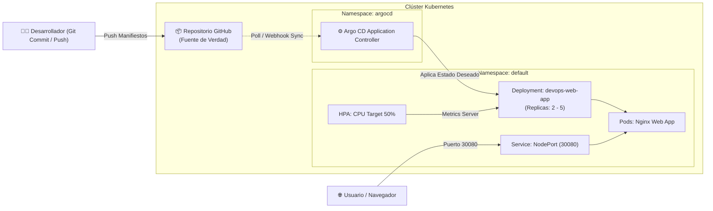

# Automatización de la Configuración Continua con Argo CD y Kubernetes (GitOps)


- **Institución:** Universidad de Las Américas (UDLA)
- **Facultad:** Facultad de Ingeniería y Ciencias Aplicadas (FICA)
- **Carrera:** Ingeniería de Software
- **Asignatura:** Procesos de Software (`ISWZ3205`)
- **NRC:** `5496 / 5497 / 5498`
- **Docente:** Ing. Mónica Sánchez Rosero, Msc.
- **Estudiante:** Carlos Alberto Angulo Pizarro (`carlos.angulo.pizarro@udla.edu.ec`)
- **Actividad:** Automatización de la configuración continua — 10% Progreso 2

---

## 🎯 Objetivo de la Práctica

Implementar el despliegue y aprovisionamiento continuo de una aplicación web contenerizada en **Kubernetes** bajo el paradigma **GitOps**, utilizando **Argo CD** como operador de entrega continua declarativa. Se define este repositorio Git como la **única fuente de verdad** (*Single Source of Truth*), sincronizando automáticamente los cambios sobre los recursos del clúster:
1. **Deployment (`deployment.yml`):** Despliegue con 2 réplicas iniciales, selectores semánticos, sondas de salud (*liveness/readiness probes*) y cuotas explícitas de CPU/Memoria (*requests* y *limits*).
2. **Service (`service.yml`):** Exposición de tráfico externo mediante un servicio de tipo **NodePort** en el puerto `30080`.
3. **Horizontal Pod Autoscaler (`hpa.yml`):** Escalado elástico dinámico (mínimo 2 réplicas, máximo 5 réplicas) condicionado a un umbral del 50% de uso de CPU a través de **Metrics Server**.
4. **Argo CD Application (`application.yml`):** Manifiesto declarativo que conecta Argo CD con el repositorio, habilitando reconciliación y auto-curación automática (*Automated Sync & Self-Healing*).

---

## 🏗️ Arquitectura GitOps y Flujo de Sincronización



---

## 📂 Estructura del Repositorio

```text
├── k8s/
│   ├── deployment.yml      # Manifiesto del Deployment (2 réplicas, requests/limits CPU/RAM)
│   ├── service.yml         # Servicio NodePort (Puerto 30080 -> 80)
│   ├── hpa.yml             # Horizontal Pod Autoscaler v2 (Min: 2, Max: 5, Target: 50% CPU)
│   └── application.yml     # Manifiesto de Argo CD Application con Automated Sync
├── img/                    # Capturas de pantalla de evidencia técnica
└── README.md               # Documentación y memoria técnica
```

---

## 🚀 Guía de Despliegue y Ejecución

### 1. Prerrequisitos en el Clúster
Asegurarse de tener un clúster Kubernetes activo con **Metrics Server** y **Argo CD** instalados:
```bash
# 1. Habilitar Metrics Server (en Minikube):
minikube addons enable metrics-server

# 2. Instalar Argo CD en su namespace dedicado:
kubectl create namespace argocd
kubectl apply -n argocd -f https://raw.githubusercontent.com/argoproj/argo-cd/stable/manifests/install.yaml

# 3. Acceder al dashboard de Argo CD:
kubectl port-forward svc/argocd-server -n argocd 8080:443
```

### 2. Registrar la Aplicación en Argo CD
Aplicar el manifiesto declarativo de la aplicación:
```bash
kubectl apply -f k8s/application.yml
```
O bien mediante la interfaz gráfica web de Argo CD:
- **Application Name:** `devops-gitops-app`
- **Project:** `default`
- **Sync Policy:** `Automatic` (Prune: enabled, Self-Heal: enabled)
- **Repository URL:** `https://github.com/Elnuget/argocd-kubernetes-gitops-udla.git`
- **Revision:** `HEAD`
- **Path:** `k8s`
- **Destination Cluster:** `https://kubernetes.default.svc`
- **Namespace:** `default`

### 3. Verificar la Sincronización Automática
```bash
kubectl get deployments,pods,services,hpa -o wide
```
Argo CD detectará los archivos en el directorio `k8s/` y desplegará:
- 2 Pods de `devops-web-app` en estado `Running`.
- El servicio `devops-web-service` exponiendo el puerto NodePort `30080`.
- El objeto `HorizontalPodAutoscaler` leyendo métricas de CPU.

---

## ⚡ Prueba de Carga y Autoescalado (HPA)

Para comprobar el escalado dinámico del **Horizontal Pod Autoscaler**:

1. En una terminal, monitorear el estado del HPA y los Pods:
   ```bash
   kubectl get hpa devops-web-hpa --watch
   ```
2. Generar carga artificial de solicitudes HTTP hacia el servicio:
   ```bash
   kubectl run load-generator --image=busybox:1.36 --restart=Never -- /bin/sh -c "while true; do wget -q -O- http://devops-web-service; done"
   ```
3. **Comportamiento observado:**
   - La utilización de CPU se eleva por encima del **50%**.
   - El HPA escala progresivamente de **2 a 5 réplicas**.
   - Al detener el generador (`kubectl delete pod load-generator`), el HPA estabiliza y desciende gradualmente a **2 réplicas**.

---

## 🔄 Prueba de GitOps (Sincronización Continua)

1. Modificar cualquier parámetro en Git (por ejemplo, cambiar la imagen a una nueva versión o ajustar variables en `deployment.yml`).
2. Realizar `git commit` y `git push`.
3. Argo CD detecta el cambio automáticamente en su ciclo de reconciliación y actualiza el estado del clúster sin intervención manual (`Zero-Touch Deployment`).

---

## 👨‍💻 Autor
- **Carlos Alberto Angulo Pizarro**
- Estudiante de 9no Semestre de Ingeniería de Software — Universidad de Las Américas (UDLA)
- GitHub: [@Elnuget](https://github.com/Elnuget)
